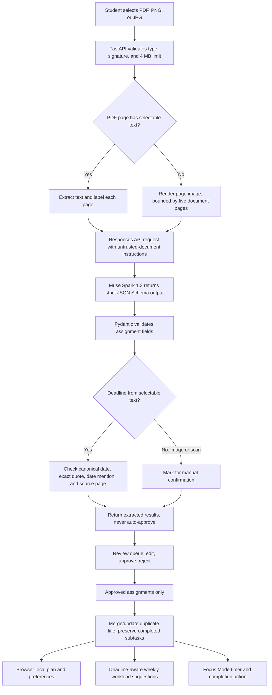

# Syllabus SOS Architecture

## Components

| Layer | Responsibility |
| --- | --- |
| React/Vite frontend | Uploads documents, presents the review queue, stores approved plan state, renders calendar/workload views, preferences, and Focus Mode. |
| FastAPI `/api/analyze` | Checks MIME type, byte signature, and 4 MB limit; extracts PDF text or renders scanned pages; calls Muse Spark; validates structured response and deadline evidence. |
| FastAPI `/api/plan` | Sorts approved assignments and returns a bounded list of incomplete subtasks for the daily-plan panel. |
| PyMuPDF | Extracts selectable text page by page and renders scanned pages (bounded to the first five document pages without text). |
| Meta Model API | Muse Spark 1.3 interprets document content and returns JSON constrained by the app’s assignment schema. Requests use Bearer authentication and `store: false`. |
| Browser local storage | Persists approved assignments, completed subtasks, edited dates, daily plan, source filename, and study preferences on that browser only. |

## Data flow

## Evidence rules

- Selectable PDF text is labeled `[PAGE n]` before it is sent to the model.
- A text-derived deadline is retained only when the date parses as canonical `YYYY-MM-DD`, the exact supporting excerpt is present on a page, and the excerpt contains the month/day (or equivalent full date) claimed by the model.
- The server derives `source_page` from the matched page. It does not trust a page number supplied by the model.
- If a date or quote fails checks, the date is cleared, confidence is lowered, and the result is marked for review.
- For image/scanned input, no textual proof can be established by this backend. Extracted deadlines remain labeled for manual checking; approval is the student's decision, not an automatic accuracy guarantee.
- “Quote matched” means text and date were found together. It is not a guarantee that the assignment interpretation is correct.

## API request and response

`POST /api/analyze` accepts one PDF, PNG, or JPEG as multipart `file`. FastAPI returns an analysis response with `assignments`, `daily_plan`, `source_name`, and `ai_mode`. Each assignment includes a nullable deadline, source excerpt, server-derived source page when available, and `evidence_status` (`source_matched`, `manual_review`, `no_deadline`, or `student_confirmed`).

`POST /api/plan` accepts validated assignments and `available_hours_per_day`; it returns deadline-ordered work while skipping completed subtasks. The frontend’s week-level balancing is a local deterministic suggestion based on deadlines, preferred study days, and daily capacity.

Health: `GET /api/health`. The health response indicates whether `MODEL_API_KEY` is present; it does not prove the key is authorized. The live synthetic smoke test is separately recorded in `SUBMISSION_CHECKLIST.md`.

## Failure behavior

- Unsupported content, mismatched signatures, malformed PDFs, and oversized uploads return client-visible HTTP errors.
- The 4 MB upload cap stays below Vercel Functions’ 4.5 MB request-body limit, which includes multipart framing.
- Missing API credentials return HTTP 503.
- Network errors, transient 408/429/5xx responses, malformed JSON, schema mismatch, and other API errors produce a bounded retry or explicit gateway error. No mock result is substituted.
- The API key is read only from the backend environment; it is never placed in Vite environment values or logged.

## State and privacy boundaries

The uploaded bytes are held in memory during the request and sent to Meta for analysis. This demo does not persist the source file. Plans and preference values are stored in local storage on the user’s device. There is no backend user table, authentication, cross-device synchronization, or deployment configured.

## Official API references

- [Meta Model API overview](https://dev.meta.ai/docs/overview)
- [Responses API](https://dev.meta.ai/docs/protocols/responses)
- [Structured output](https://dev.meta.ai/docs/structured-output)
