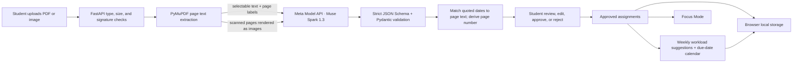

# Syllabus SOS

**We don’t just tell students what’s due. We help them choose what to do next.** Syllabus SOS turns course documents into an editable, evidence-aware study plan.

This project is open source under the [MIT License](LICENSE).

## Product

Students upload a syllabus, assignment PDF, course announcement, or screenshot. Meta Muse Spark extracts likely assignments, dates, requirements, and smaller steps. Before results enter the plan, students review, edit, approve, or reject each item. Selectable-PDF deadlines need a matching date quote on a source page; dates read from images are explicitly marked for manual confirmation.

Approved assignments feed a weekly workload view that uses the student’s available hours and preferred study days. Focus Mode offers a task description, remaining work, a configurable timer, and a mark-complete action. Plans and study preferences are stored in that browser’s local storage.

## Status

The current local build and the synthetic upload-to-review-to-approval workflow are verified. A synthetic, non-personal assignment PDF returned a live Muse Spark result with its deadline quote matched to page 1. Backend tests and the frontend production build passed; see [SUBMISSION_CHECKLIST.md](SUBMISSION_CHECKLIST.md) for exact results and remaining work.

Sample assignments on first visit are demo content. They are replaced when the first real assignment is approved. Do not present sample data as AI output.

## Features

- PDF, PNG, and JPEG uploads (10 MB maximum), including scanned-PDF rendering for up to five document pages.
- Muse Spark structured extraction for assignments, dates, requirements, estimated effort, dependencies, missing information, and subtasks.
- Review queue with editable title, deadline, description, requirements, and effort; approve, reject, or approve high-confidence dates whose exact quote and date match selectable PDF text.
- Evidence badges distinguish a quote matched to selectable text, image-derived information requiring manual review, and no deadline found. Matched excerpts show their PDF page number.
- Exact-title duplicate detection and update behavior; existing completed subtasks are preserved when an assignment is updated.
- Editable plan, due-date calendar, weekly workload suggestions, study-day/hour preferences, and browser-local persistence.
- Focus Mode with a configurable start/pause timer and task completion.
- Bounded retries for transient Meta API failures; invalid model output, missing keys, and unsupported uploads produce visible errors rather than fake AI results.

## Technology and API

- Frontend: React, Vite, and Lucide icons.
- Backend: FastAPI, Pydantic, HTTPX, and PyMuPDF.
- Model: `muse-spark-1.3` through Meta Model API’s Responses endpoint. The key stays in the backend environment; requests set `store: false`.
- Persistence: browser local storage; no account, database, or cross-device sync.

The implementation follows Meta’s [Responses API](https://dev.meta.ai/docs/protocols/responses), [structured-output guide](https://dev.meta.ai/docs/structured-output), and [Model API overview](https://dev.meta.ai/docs/overview). The Responses API supports typed text/image inputs; the app uses `text.format` JSON Schema output and sends image data as base64 data URLs.

## Run locally

Requirements: Python 3.11+ and Node.js 20.19+ (or 22.12+).

```bash
# Terminal 1 — backend
cd backend
python -m venv .venv
source .venv/bin/activate          # Windows: .venv\Scripts\activate
pip install -r requirements.txt
cp .env.example .env               # Add MODEL_API_KEY to this local file
set -a
source .env                        # Loads values without printing the key
set +a
uvicorn main:app --reload --port 8000

# Terminal 2 — frontend, from the project root
cd frontend
npm install
npm run dev
```

Open http://localhost:5173. Health status: http://localhost:8000/api/health. The backend does not read `.env` by itself; export its variables in the shell as above. Keep `backend/.env` private and never commit it. Set `CORS_ORIGINS` on the backend to the exact frontend origins you use. Set `VITE_API_URL` in the frontend environment only when the API is not at `http://localhost:8000`.

## Verify locally

```bash
cd backend
.venv/bin/python -m unittest -v test_main.py
cd ../frontend
npm run build
```

The tests mock Meta API responses except for the documented synthetic live smoke test. Unit tests do not establish general extraction accuracy. Recheck dates and requirements in original documents, especially screenshots and scans.

## Data flow



See [ARCHITECTURE.md](ARCHITECTURE.md) for component behavior and boundaries.

## Privacy and security

The selected document is sent to Meta Model API for analysis and is not saved by this demo. Model requests use `store: false`. Extracted assignments and preferences stay in browser local storage on that device. The app treats document contents as untrusted input and does not follow embedded instructions. There is no user authentication or server-side storage. Do not deploy the open upload endpoint publicly without request limits or an access gate; model calls can incur usage charges.

## Screenshots

No checked-in screenshots are included yet. Capture the real review flow and approved plan using the final demo configuration; do not use the illustrative sample workspace as if it were model output.

## Deployment

Render and Vercel scaffolding is present in `render.yaml`, `backend/Dockerfile`, and `frontend/vercel.json`. The app is **not deployed**. For Render, set `MODEL_API_KEY` and `CORS_ORIGINS` in the service environment. For Vercel, set `VITE_API_URL` to the deployed backend and use `frontend/` as the project root. Verify the public endpoint and protect it from unbounded use before sharing a URL.

## Demo

Use [DEMO_SCRIPT.md](DEMO_SCRIPT.md) for the 90-second walkthrough. Use [SUBMISSION_CHECKLIST.md](SUBMISSION_CHECKLIST.md) to track what is and is not verified.

## Known limitations

- Image- and scan-derived dates cannot be checked against extracted text; review them manually against the original.
- Only the first five PDF pages without selectable text are rendered. Later scanned pages are explicitly omitted; split long scans before upload.
- The local workload scheduler uses estimated task hours and simple deadline ordering. It is a suggestion, not a guaranteed schedule; a task can still push a day over the selected capacity.
- Duplicate detection is exact normalized-title based; it does not guarantee semantic duplicate detection.
- Plans/preferences are browser-local, without accounts or cross-device sync.
- No public deployment or owner-selected academic document evaluation has been completed.

## Hackathon submission description

Syllabus SOS turns academic chaos into a student’s next actionable step. Upload a syllabus, assignment PDF, or course screenshot; Muse Spark extracts likely assignments and requirements, then the student reviews the evidence and corrects uncertainty before work enters an editable plan. A personalized workload view and timed Focus Mode connect document understanding to concrete progress.
